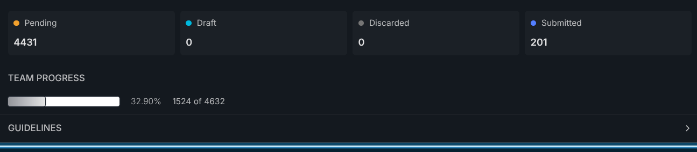

## La Novitade

### Meta

Sto andando avanti con la preparazione alla fusione dei Responsible Agents, correggendo prima i problemi che renderebbero questa fusione più rischiosa.

Ho cancellato 7.259.117 AR il cui BR non esiste più. Sono rimasti orfani dopo il processo di fusione avvenuto il 6/12/2024.

### API

Ho fatto qualche prova sui dati di produzione per confrontare l'orchestrazione di RAMOSE con SERVICE, sfruttando le ottimizzazioni previste tra due endpoint QLever. Nel complesso non ho visto grandi vantaggi. Sulla richiesta di una singola citazione si risparmia circa un decimo di secondo, mentre sulle altre query i risultati sono meno convincenti, con rallentamenti e, nel caso di Meta, timeout con più richieste contemporanee. Per ora non mi sembra che valga la pena cambiare l'orchestrazione.

### HERITRACE

<video class="sl-obs-embed-video" controls src="/notes/attachments/screenrecording-2026-10-10_18-44-36.mp4"></video>

### Aldrovandi

Il record con hasNote più lungo: [https://zenodo.org/records/20436731](https://zenodo.org/records/20436731)

Nuovo indice: [https://doi.org/10.5281/zenodo.23222537](https://doi.org/10.5281/zenodo.23222537)

### time-agnostic-library

[https://github.com/rdfostrich/ostrich/issues/11](https://github.com/rdfostrich/ostrich/issues/11)

### Lorenzo

