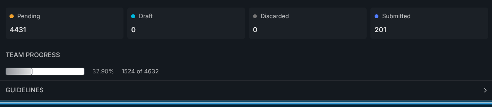

## La Novitade

### Meta

Sto andando avanti con la preparazione alla fusione dei Responsible Agents, correggendo prima i problemi che renderebbero questa fusione più rischiosa.

Ho cancellato 7.259.117 AR il cui BR non esiste più. Sono rimasti orfani dopo il processo di fusione avvenuto il 6/12/2024.

### API

Ho fatto qualche prova sui dati di produzione per confrontare l'orchestrazione di RAMOSE con SERVICE, sfruttando le ottimizzazioni previste tra due endpoint QLever. Nel complesso non ho visto grandi vantaggi. Sulla richiesta di una singola citazione si risparmia circa un decimo di secondo, mentre sulle altre query i risultati sono meno convincenti, con rallentamenti e, nel caso di Meta, timeout con più richieste contemporanee. Per ora non mi sembra che valga la pena cambiare l'orchestrazione.

### HERITRACE

<video class="sl-obs-embed-video" controls src="/notes/attachments/screenrecording-2026-10-10_18-44-36.mp4"></video>

### Aldrovandi

Il record con hasNote più lungo: [https://zenodo.org/records/20436731](https://zenodo.org/records/20436731)

Nuovo indice: [https://doi.org/10.5281/zenodo.23222537](https://doi.org/10.5281/zenodo.23222537)

### time-agnostic-library

[https://github.com/rdfostrich/ostrich/issues/11](https://github.com/rdfostrich/ostrich/issues/11)

### Lorenzo

## Domande

## Memo

GRAPHIA

* Bisogna aggiungere un convenience filter per i prodotto per venue. L'input è l'id, che sia local.

META

* Disambiguare gli editori. Inserirla nel processo di patch. Completare il merge.
* Prossimo dump. Eliminare citazioni duplicate.
* Aggiornare oc\_sparql per la provenance

RAMOSE

* Confronto performance
* Aggiungere connextion
* Chiarire di non usare LIMIT con @@page

TAL

* Aggiungere skolemizzazione

Vizioso

* [https://en.wikipedia.org/wiki/Compilers:\_Principles,\_Techniques,\_and\_Tools](https://en.wikipedia.org/wiki/Compilers:_Principles,_Techniques,_and_Tools)
* [https://en.wikipedia.org/wiki/GNU\_Bison](https://en.wikipedia.org/wiki/GNU_Bison)
* [https://en.wikipedia.org/wiki/Yacc](https://en.wikipedia.org/wiki/Yacc)

HERITRACE

* anni: essere meno stretto sugli anni. Problema ISO per 999. 0999?
* Timer massimo. Timer configurabile. Messaggio in caso si stia per toccare il timer massimo.
* Riflettere su @lang. SKOS come use case. skos:prefLabel, skos:altLabel
* Possibilità di specificare l’URI a mano in fase di creazione
* description con l'entità e stata modificata. Tipo commit
* display name è References Cited by VA bene
* Avvertire l'utente del disastro imminente nel caso in cui provi a cancellare un volume

Meta

* Usare il triplestore di provenance per fare 303 in caso di entità mergiate o mostrare la provenance in caso di cancellazione e basta.

oc\_ocdm

* Automatizzare mark\_as\_restored di default. è possibile disabilitare e fare a mano mark\_as\_restored.
* [https://opencitations.net/meta/api/v1/metadata/doi:10.1093/acprof:oso/9780199977628.001.0001](https://opencitations.net/meta/api/v1/metadata/doi:10.1093/acprof:oso/9780199977628.001.0001)
* DELETE con variabile
* Modificare Meta sulla base della tabella di Elia
* embodiment multipli devono essere purgati a monte
* Modificare documentazione API aggiungendo omid
* aggiungere Relation sovraclasse di Citazione e Menzione

Crowdsourcing

* Quando dobbiamo ingerire Crossref stoppo manualmente OJS. Si mette una nota nel repository per dire le cose. Ogni mese.
* Aggiornamenti al dump incrementali. Si usa un nuovo prefisso e si aggiungono dati solo a quel CSV.
* Bisogna usare il DOI di Zenodo come primary source. Un unico DOI per batch process.
* Bisogna fare l’aggiornamento sulla copia e poi bisogna automatizzare lo switch

Citazioni

* Fare diff DataCite per togliere le citazioni che non sono più citazioni. è da fare in post. Snapshot 2 di provenance. Fare lo snapshot 3 con la creazione con il derived from al nuovo dump. La lineage viene data dallo specialization of. Colleghi sia al 2 che al dump.
* Repo cerotti. meta/index/sorgenti

OC di converter

* Riguardare perché viene fuori una seconda tabella object per DataCite.
