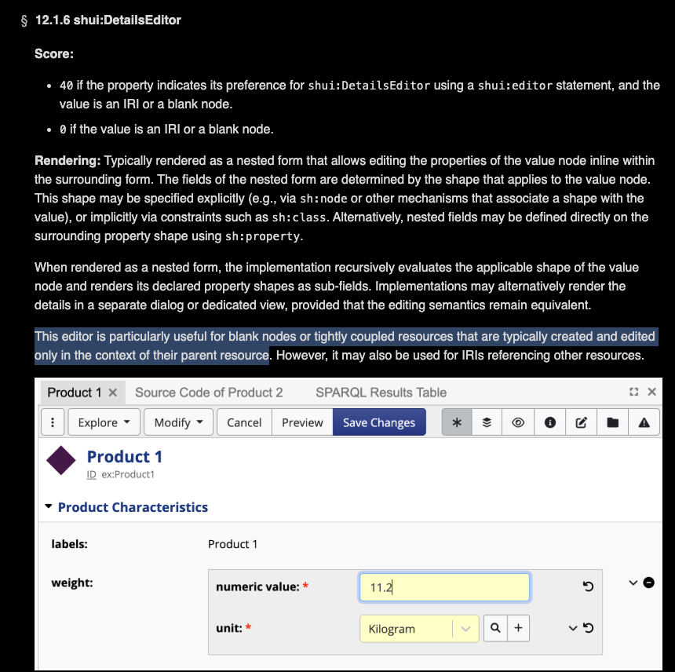

## La Novitade

### Articolo sulla Time Agnostic Library

**Perché non usate il Data History Plugin di GraphDB come baseline?**

Perché non va: [https://stackoverflow.com/questions/80014673/graphdb-history-plugin-from-http-www-ontotext-com-at-returns-current-da](https://stackoverflow.com/questions/80014673/graphdb-history-plugin-from-http-www-ontotext-com-at-returns-current-da)

### HERITRACE

#### Da YAML a SHACL

Ho spostato da YAML a SHACL tutto ciò che è esprimibile tramite [SHACL 1.2 User Interfaces](https://w3c.github.io/data-shapes/shacl12-ui/) e [SHACL 1.2 extensions](https://w3c.github.io/data-shapes/shacl12-sparql/). Sono entrambi draft, ma in ogni caso per portare quelle regole da YAML a RDF avrei dovuto definire un vocabolario, quindi tanto vale utilizzarne uno su cui sta lavorando qualcun altro.

* displayName della classe -> sh:name sulla node shape
* displayName del campo -> sh:name sulla property shape
* ordine dei displayProperties -> sh:order
* displayRules per shape (Author/Editor/Publisher sullo stesso predicato) → una property shape per ruolo, con lo stesso path e sh:node diverso
* fetchUriDisplay -> property shape con shui:LabelRole e la query in sh:values/sh:select, con \$this al posto di `[[uri]]`
* inputType: textarea -> shui:editor shui:TextAreaEditor
* supportsSearch -> shui:editor shui:AutoCompleteEditor
  * sulla property shape del link, con sh:class o sh:node della destinazione
  * si dichiara sul campo che punta all’entità da cercare, per esempio su pro:isHeldBy
  * la query si ricava dai campi di testo della shape di destinazione e da quelli annidati di un livello, quindi posso cercare i nomi di un autore e anche i suoi id.

TopQuadrant è un azienda che fa software per gestire knowledge graph. II suo prodotto principale è TopBraid EDG. Ha contribuito a definire SHACL. Anche SHACL UI riprende in qualche misura il vocabolario [DASH](https://datashapes.org/dash.ttl) definito per TopBraid. In DASH ci sono alcune proprietà che fanno cose non ancora integrate in SHACL UI ma utili per HERITRACE, per abbandonare definitivamente YAML senza creare neanche una nuova proprietà e riutilizzare al 100% l'esistente.

```
dash:composite
  a rdf:Property ;
  rdfs:comment "Can be used to indicate that a property/path represented by a property constraint represents a composite relationship. In a composite relationship, the life cycle of a \"child\" object (value of the property/path) depends on the \"parent\" object (focus node). If the parent gets deleted, then the child objects should be deleted, too. Tools may use dash:composite (if set to true) to implement cascading delete operations." ;
  rdfs:domain sh:PropertyShape ;
  rdfs:label "composite" ;
  rdfs:range xsd:boolean ;
.
```

```turtle
sh:property [
	sh:name "Author" ;
	sh:path pro:isDocumentContextFor ;
	sh:node schema:AuthorShape ;
	shui:editor shui:DetailsEditor ;
	shui:viewer shui:DetailsViewer ;
	dash:composite true ;
] .
```



dash:composite ha senso anche su identificatori, manifestazioni, citazioni, non solo sui proxy. È un concetto più generale.

dash:composite insieme a shui:editor shui:DetailsEditor ci permette di gestire il concetto proxy.

E le proprietà virtuali? Le togliamo. Il problema delle citazioni si può risolvere con un path inverso

```turtle
schema:JournalArticleShape
  sh:property [
    sh:path [ sh:inversePath cito:hasCitingEntity ] ;
    sh:name "Citations" ;
    sh:node schema:CitationShape ;
    dash:composite true ;
  ] .
  

```

Dentro Citations il campo hasCitingEntity non viene mostrato, perché è già noto, è l'articolo.

E la possibilità di nascondere intere classi? Sparisce.

Prima

```yaml
- target:
    class: "http://purl.org/spar/fabio/JournalArticle"
  displayName: "Journal Article"
  fetchUriDisplay: |
    SELECT ?display WHERE { [[uri]] dcterms:title ?title ... }
  displayProperties:
    - property: "http://purl.org/spar/pro/isDocumentContextFor"
      orderedBy: "https://w3id.org/oc/ontology/hasNext"
      displayRules:
        - shape: "http://schema.org/AuthorShape"
          displayName: "Author"
        - shape: "http://schema.org/EditorShape"
          displayName: "Editor"
```

Ora

```turtle
schema:JournalArticleShape
  a sh:NodeShape ;
  sh:name "Journal Article" ;
  sh:targetClass fabio:JournalArticle ;
  sh:property [
    sh:path pro:isDocumentContextFor ;
    sh:name "Author" ;
    sh:order 4 ;
    sh:node schema:AuthorShape ;
  ] ;
  sh:property [
    sh:path pro:isDocumentContextFor ;
    sh:name "Editor" ;
    sh:order 5 ;
    sh:node schema:EditorShape ;
  ] ;
  sh:property [
    sh:path rdfs:label ;
    shui:propertyRole shui:LabelRole ;
    sh:values [ sh:select "SELECT ?label WHERE { $this dcterms:title ?title ... }" ] ;
  ] .
```

Ho anche aggiunto nella documentazione una sezione che elenca quale porzione del vocabolario SHACL stiamo supportando e quale no: [https://opencitations.github.io/heritrace/configuration/shacl/](https://opencitations.github.io/heritrace/configuration/shacl/)

#### Interfaccia di configurazione

`ADMIN_ORCIDS` per indicare la lista degli ORCID autorizzati a configurare l'applicazione

Come si fa a rendere modificabile con HERITRACE delle SHACL shapes rendendo l'interfaccia usabile? O si crea un'interfaccia ad hoc per le shapes, oppure si riutilizza lo stesso motore di HERITRACE definendo una meta-shape immutabile. La meta-shape utilizza le stesse regole di visualizzazione fornite da SHACL UI per rendere leggibili i form di modifica delle shapes personalizzate.

Corollario 1: il sottoinsieme di SHACL supportato da HERITRACE diventa machine readable.

Corollario 2: SHACL viene validato tramite SHACL.

Corollario 3: anche le modifiche allo SHACL hanno provenance e change tracking

*Sed quis custodiet ipsos custodes*? Nessuno, se la meta-shape è sbagliata tutte le shape costruite a partire da essa saranno sbagliate.

IRI base: [https://w3id.org/heritrace/](https://w3id.org/heritrace/). Viene usato nella meta-shape per:

* La radice: l'entità sh:ShapesGraph che contiene tutti i tipi di entità (heritrace:configuration)
* …/meta/…: le shape della meta-shape (ShapesGraphShape, NodeShapeShape, PropertyShapeShape)
* heritrace:system, l’agente a cui viene attribuita la prima versione della configurazione, quella letta da un shacl.ttl senza provenance
* …/genid/…: HERITRACE lavora su entità, non su nodi anonimi, ma SHACL usa quasi solo nodi anonimi. Gli IRI genid risolvono questo problema. Ogni nodo anonimo riceve un IRI inventato, `https://w3id.org/heritrace/genid/<uuid>`.
* `…/shape/<uuid>`: IRI stabili dei tipi di entità creati dall’app

Mentre un amministratore sta modificando la configurazione si applica lo stesso blocco che vale per le entità del dataset.

### Meta

Fusione dei RA finita. Avanti coi BR.

## Domande

## Memo

GRAPHIA

* Bisogna aggiungere un convenience filter per i prodotto per venue. L'input è l'id, che sia local.

META

* Disambiguare gli editori. Inserirla nel processo di patch. Completare il merge.
* Prossimo dump. Eliminare citazioni duplicate.
* Aggiornare oc\_sparql per la provenance

RAMOSE

* Confronto performance
* Aggiungere connextion
* Chiarire di non usare LIMIT con @@page
* Gestire la memoria a livello di API
* Rimuovere le ridondanze in oc\_api
* Consentire a Ramose di essere controllato tramite variabili d'ambiente

TAL

* Aggiungere skolemizzazione

Vizioso

* [https://en.wikipedia.org/wiki/Compilers:\_Principles,\_Techniques,\_and\_Tools](https://en.wikipedia.org/wiki/Compilers:_Principles,_Techniques,_and_Tools)
* [https://en.wikipedia.org/wiki/GNU\_Bison](https://en.wikipedia.org/wiki/GNU_Bison)
* [https://en.wikipedia.org/wiki/Yacc](https://en.wikipedia.org/wiki/Yacc)

HERITRACE

* anni: essere meno stretto sugli anni. Problema ISO per 999. 0999?
* Timer massimo. Timer configurabile. Messaggio in caso si stia per toccare il timer massimo.
* Riflettere su @lang. SKOS come use case. skos:prefLabel, skos:altLabel
* Possibilità di specificare l’URI a mano in fase di creazione
* description con l'entità e stata modificata. Tipo commit
* display name è References Cited by VA bene
* Avvertire l'utente del disastro imminente nel caso in cui provi a cancellare un volume

Meta

* Usare il triplestore di provenance per fare 303 in caso di entità mergiate o mostrare la provenance in caso di cancellazione e basta.

oc\_ocdm

* Automatizzare mark\_as\_restored di default. è possibile disabilitare e fare a mano mark\_as\_restored.
* [https://opencitations.net/meta/api/v1/metadata/doi:10.1093/acprof:oso/9780199977628.001.0001](https://opencitations.net/meta/api/v1/metadata/doi:10.1093/acprof:oso/9780199977628.001.0001)
* DELETE con variabile
* Modificare Meta sulla base della tabella di Elia
* embodiment multipli devono essere purgati a monte
* Modificare documentazione API aggiungendo omid
* aggiungere Relation sovraclasse di Citazione e Menzione

Crowdsourcing

* Quando dobbiamo ingerire Crossref stoppo manualmente OJS. Si mette una nota nel repository per dire le cose. Ogni mese.
* Aggiornamenti al dump incrementali. Si usa un nuovo prefisso e si aggiungono dati solo a quel CSV.
* Bisogna usare il DOI di Zenodo come primary source. Un unico DOI per batch process.
* Bisogna fare l’aggiornamento sulla copia e poi bisogna automatizzare lo switch
* Documentare come mettere su il repo di crowdsourcing, ad esempio la gestione dei secreti

Citazioni

* Fare diff DataCite per togliere le citazioni che non sono più citazioni. è da fare in post. Snapshot 2 di provenance. Fare lo snapshot 3 con la creazione con il derived from al nuovo dump. La lineage viene data dallo specialization of. Colleghi sia al 2 che al dump.
* Repo cerotti. meta/index/sorgenti

OC di converter

* Riguardare perché viene fuori una seconda tabella object per DataCite.
